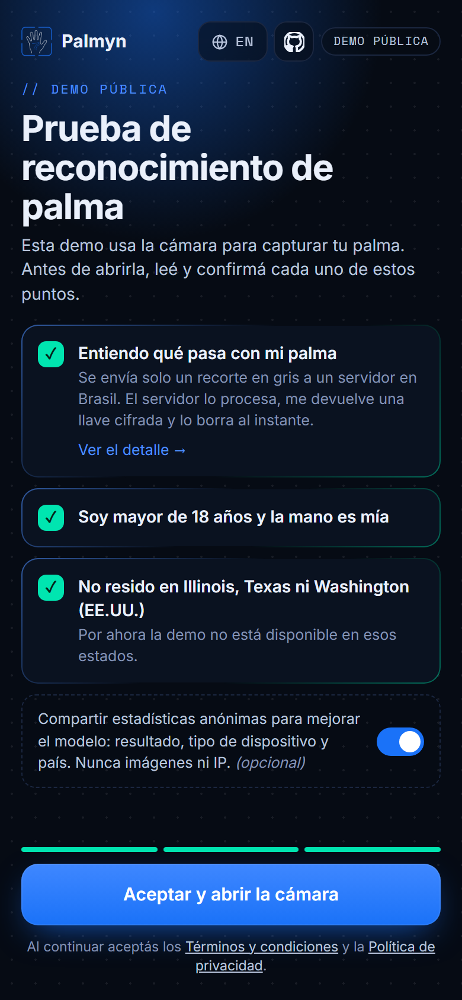
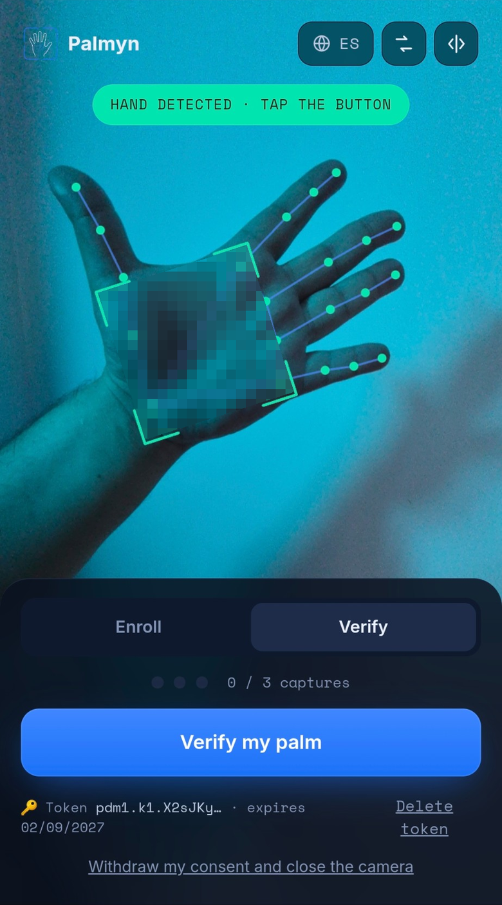
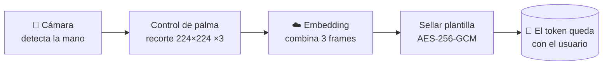
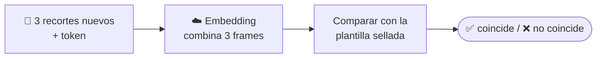

# Palmyn — reconocimiento de palma con la cámara de cualquier celular

**Biometría de palma sin contacto, con el celular que ya tenés
y sin guardar datos biométricos en el servidor.**

[**Probá la demo →**](https://demo.palmyn.com) &nbsp;·&nbsp; [palmyn.com](https://palmyn.com) &nbsp;·&nbsp; [Read in English](README.md)

---

<table>
<tr>
<td width="50%" valign="top"></td>
<td width="50%" valign="top"></td>
</tr>
<tr>
<td align="center" valign="top">Consentimiento punto por punto: la cámara se abre recién cuando aceptás todo.</td>
<td align="center" valign="top">El seguimiento de la mano en vivo guía la captura, acá con poca luz y teñida. La palma está pixelada solo en este README, no en la app.</td>
</tr>
</table>

## Por qué la palma

La palma tiene un patrón denso de líneas principales, arrugas y textura que es único de cada
persona, se mantiene estable con los años y es difícil de capturar sin querer. A diferencia de la
cara, no aparece en cada foto, y a diferencia de la huella no necesita un sensor: alcanza con la
cámara de un celular común.

Sobre eso Palmyn construye una **prueba de humanidad y de identidad** que cualquiera puede usar
desde el navegador, sin instalar nada y sin entregar su biometría a una base de datos. Esta demo
muestra el núcleo de reconocimiento; mirá [lo que todavía no hace](#lo-que-esta-demo-no-hace).

## Qué lo hace distinto

- 📱 **Cualquier celular, sin hardware especial.** El seguimiento de la mano, la alineación y el
  recorte corren en el navegador. Del dispositivo sale solo un recorte de 224×224 en gris de la
  palma, nunca la foto ni el video.
- 🔐 **El servidor no guarda nada.** Cada pedido se procesa en memoria y se borra. La plantilla
  biométrica se sella con AES-256-GCM y vuelve al usuario como un token: cada persona tiene su
  propia credencial y no existe una base biométrica que se pueda filtrar.
- 🖐️ **La palma, no el dorso.** Un esqueleto de 21 puntos guía al usuario en vivo, y un
  control geométrico rechaza el dorso de la mano antes de capturar.
- 🎯 **Fusión de varios frames.** Se capturan tres frames al enrolar y tres al verificar, y se
  combinan en una sola plantilla. Eso solo reduce el error unas cinco veces (ver
  [Resultados](#resultados)).
- 🛡️ **Protegido contra el sondeo.** Solo responde coincide / no coincide, limita los intentos
  por IP y por token, rechaza imágenes vacías, exige una cantidad fija de frames, y usa tokens
  atados al modelo, con vencimiento y claves rotables.
- ✅ **Consentimiento y privacidad desde el diseño.** Una casilla por declaración, estadísticas
  anónimas opcionales que nunca incluyen imágenes ni IP, y borrado automático a los 12 meses.

## Cómo funciona

**Enrolar**

**Verificar**

1. **Captura.** El navegador sigue la mano en tiempo real, controla que se vea la palma (no el
   dorso) y espera a que esté quieta.
2. **Preprocesado.** Un pipeline en JavaScript puro, sin OpenCV ni WASM pesado, alinea la palma a
   partir de sus puntos y extrae una región normalizada (filtro de mediana + CLAHE).
3. **Enrolamiento.** El servidor convierte tres recortes en una plantilla de 128 dimensiones, la
   cifra y la devuelve como token. Los recortes y la plantilla se borran enseguida.
4. **Verificación.** El usuario manda tres recortes nuevos y su token. El servidor descifra el
   token en memoria, compara, responde *coincide* o *no coincide* y olvida todo.

## Cómo lo construimos

1. **Estudiar el campo.** Partimos de la literatura de reconocimiento de palma sin contacto y del
   reconocimiento facial, que resolvió antes muchos de los mismos problemas: aprender embeddings
   compactos que mantengan lejos a personas distintas.
2. **Lograr un buen recorte.** Con un celular la mano se mueve, se inclina y cambia de distancia, así
   que buena parte del trabajo inicial fue el preprocesado. Probamos varias formas de alinear y
   recortar la palma y nos quedamos con una región basada en los puntos de la mano, en la línea de
   Zhang et al. [1], guiada por MediaPipe Hands [2] y reescrita en JavaScript puro para que corra en
   el navegador ([`web/palm_preproc.js`](web/palm_preproc.js)).
3. **Primero, identidades sintéticas.** Los datos reales de palma son escasos y sensibles, así que el
   modelo aprende primero con palmas sintéticas de personas que no existen y recién después se ajusta
   con capturas reales.
4. **Un modelo compacto con una pérdida exigente.** Una red convolucional chica, lo bastante liviana
   para correr en el dispositivo, entrenada con sub-center ArcFace [3, 4] para que cada identidad
   quede compacta y lejos de las demás.
5. **Medir con personas que el modelo no vio.** Validación cruzada sobre identidades que no
   estuvieron en el entrenamiento. Así encontramos que combinar varios frames es la palanca más
   grande (ver [Resultados](#resultados)).

Las evaluaciones más grandes entre sesiones y las protecciones de
[Lo que esta demo no hace](#lo-que-esta-demo-no-hace) siguen en curso.

**Referencias** 
[1] L. Zhang et al., "Towards contactless palmprint recognition: A novel device, a new benchmark, and a collaborative representation based identification approach," *Pattern Recognition* 69, 2017. [doi:10.1016/j.patcog.2017.04.016](https://doi.org/10.1016/j.patcog.2017.04.016) 
[2] F. Zhang et al., "MediaPipe Hands: On-device Real-time Hand Tracking," 2020. [arXiv:2006.10214](https://arxiv.org/abs/2006.10214) 
[3] J. Deng et al., "ArcFace: Additive Angular Margin Loss for Deep Face Recognition," *CVPR* 2019. [arXiv:1801.07698](https://arxiv.org/abs/1801.07698) 
[4] J. Deng et al., "Sub-center ArcFace: Boosting Face Recognition by Large-Scale Noisy Web Faces," *ECCV* 2020. [doi:10.1007/978-3-030-58621-8_43](https://doi.org/10.1007/978-3-030-58621-8_43)

## Resultados

Benchmark interno con capturas de celular, validación cruzada de 5 particiones sobre identidades
que el modelo no vio. Combinar varios frames es la palanca más grande:

| Frames (enrolar / verificar) | EER | TAR @ FAR 0,1% |
|:---:|:---:|:---:|
| 1 / 1 | 9,70% | 62,5% |
| 3 / 1 | 4,57% | 80,6% |
| **3 / 3 (esta demo)** | **1,83%** | **93,0%** |
| 5 / 3 | 1,18% | 96,1% |

EER: tasa de error igual. TAR @ FAR 0,1%: usuarios legítimos aceptados cuando solo pasa 1 de
cada 1.000 intentos de impostores. Medido sobre una cantidad limitada de identidades, con
capturas de una misma sesión. Hay evaluaciones más grandes y entre sesiones en curso: tomalos
como números preliminares.

## Lo que esta demo no hace

Es una demo de la tecnología, no un sistema de autenticación para producción. **No** incluye:

- **Detección de ataques de presentación.** Nada impide que se acepte una foto, una impresión,
  una pantalla o un video de una palma.
- **Detección de imágenes generadas con IA o inyectadas.** No detecta palmas sintéticas,
  deepfakes ni imágenes metidas directo en la cámara o en la API.
- **Prueba de vida ni gestos.** No se le pide al usuario que mueva la mano ni que haga un gesto
  para demostrar que la captura es en vivo.
- **Protección anti-Sybil.** No hay base de enrolamientos, así que una misma persona puede
  enrolarse muchas veces, con cualquiera de las dos manos, y obtener varios tokens
  independientes. Nada ata un token a una sola persona.

## Por dentro

| Capa | Tecnología |
|---|---|
| Seguimiento de la mano | MediaPipe Hand Landmarker (en el dispositivo, servido desde nuestro dominio) |
| Preprocesado | JavaScript puro: alineación por puntos, filtro de mediana, CLAHE |
| Modelo | CNN compacta, embedding de 128 dimensiones, sub-center ArcFace, ONNX (~17 MB) |
| Inferencia | Node.js + ONNX Runtime, con concurrencia limitada |
| Protección de la plantilla | AES-256-GCM, atada al modelo, con vencimiento y rotación de claves |
| Web | JavaScript sin frameworks, en inglés y español, Content Security Policy estricta, fuentes propias, sin rastreadores |

## Qué hay en este repositorio

Es el código de la demo pública de [demo.palmyn.com](https://demo.palmyn.com):

| Ruta | Qué hace |
|---|---|
| [`web/demo.js`](web/demo.js) | Cámara, esqueleto de la mano en vivo, control palma/dorso, captura automática |
| [`web/palm_preproc.js`](web/palm_preproc.js) | Alineación de la palma y extracción de la región en JS puro |
| [`src/app.js`](src/app.js) | API HTTP: consentimiento, enrolar, verificar, headers de seguridad |
| [`src/token.js`](src/token.js) | Plantillas biométricas selladas que guarda el usuario |
| [`src/roi.js`](src/roi.js) | Validación de la entrada: cantidad de frames, tamaño, imágenes vacías |
| [`src/consent.js`](src/consent.js) | Consentimiento versionado, punto por punto |
| [`src/stats.js`](src/stats.js) | Estadísticas anónimas opcionales, sin IP y con borrado automático |
| [`docs/API.md`](docs/API.md) | Referencia de la API (en inglés) |

Los pesos del modelo entrenado y el pipeline de entrenamiento son propietarios y **no** están
incluidos.

## Contacto

¿Te interesa la biometría de palma para tu producto, una investigación o un piloto?
Escribinos a **[admin@palmyn.com](mailto:admin@palmyn.com)** o entrá a [palmyn.com](https://palmyn.com).

---

© 2026 PALMYN S.A.S. Todos los derechos reservados. Los componentes de terceros mantienen sus
propias licencias: MediaPipe (Apache 2.0), Inter y Space Mono (SIL Open Font License).
