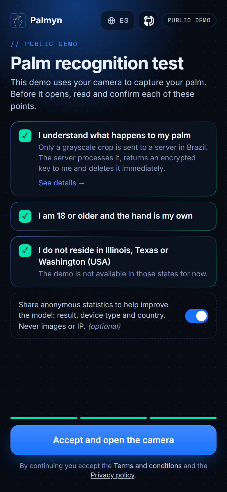
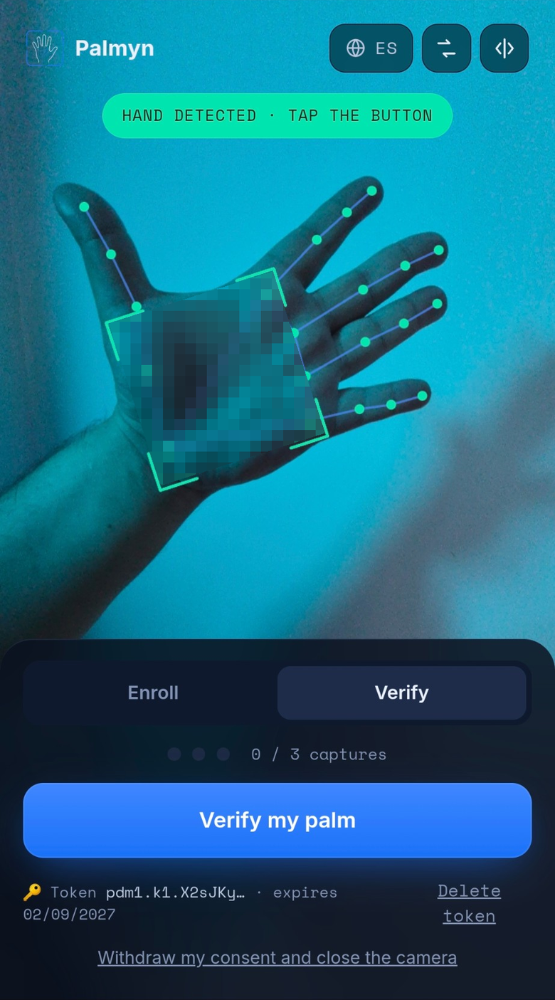
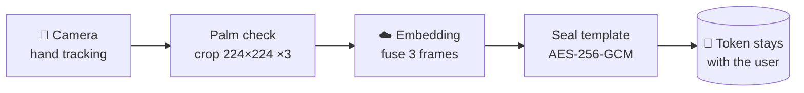
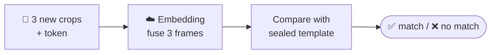

# Palmyn — palm recognition from any phone camera

**Contactless palmprint biometrics that run on the smartphone you already have,
with no biometric data stored on the server.**

[**Try the live demo →**](https://demo.palmyn.com) &nbsp;·&nbsp; [palmyn.com](https://palmyn.com) &nbsp;·&nbsp; [Leer en español](README.es.md)

---

<table>
<tr>
<td width="50%" valign="top"></td>
<td width="50%" valign="top"></td>
</tr>
<tr>
<td align="center" valign="top">Itemized consent: the camera opens only after every point is accepted.</td>
<td align="center" valign="top">Live hand tracking guides the capture, here in dim, tinted light. The palm is pixelated only in this README, not in the app.</td>
</tr>
</table>

## Why palms

Your palm carries a dense pattern of principal lines, wrinkles and texture that is unique to you,
stable over the years and hard to capture by accident. Unlike a face it is not exposed in every
photo, and unlike a fingerprint it needs no sensor: a regular phone camera is enough.

Palmyn is building on that a **proof-of-humanity and identity check** that anyone can use from a
browser, without installing anything and without handing their biometrics to a database. This
demo shows the recognition core; see [what it does not do yet](#what-this-demo-does-not-do).

## What makes it different

- 📱 **Any smartphone, no special hardware.** Hand tracking, alignment and cropping run in the
  browser. Only a 224×224 grayscale crop of the palm ever leaves the device, never the photo
  or the video.
- 🔐 **The server keeps nothing.** Each request is processed in memory and wiped. The
  biometric template is sealed with AES-256-GCM and handed back to the user as a token: the
  user holds their own credential, and there is no biometric database to breach.
- 🖐️ **Palm side, not the back.** A 21-point hand skeleton guides the user live, and a
  geometric check rejects the back of the hand before anything is captured.
- 🎯 **Multi-frame fusion.** Three frames are captured on enrollment and three on verification
  and fused into one template. That alone cuts the error rate about five-fold (see
  [Results](#results)).
- 🛡️ **Hardened against probing.** Match/no-match answers only, per-IP and per-token rate
  limits, rejection of blank inputs, a fixed number of frames, model-bound tokens that expire, and
  rotatable encryption keys.
- ✅ **Consent and privacy by design.** One checkbox per declaration, opt-in anonymous
  statistics that never include images or IP addresses, and automatic deletion after 12 months.

## How it works

**Enroll**

**Verify**

1. **Capture.** The browser tracks the hand in real time, checks that the palm (not the back)
   faces the camera and waits until it is steady.
2. **Preprocess.** A pure-JavaScript pipeline, with no OpenCV and no WASM bloat, aligns the
   palm from its landmarks and extracts a normalized region of interest (median filter + CLAHE).
3. **Enroll.** The server turns three crops into one 128-dimensional template, encrypts it and
   returns it as a token. Crops and template are zeroed out right after.
4. **Verify.** The user sends three new crops plus their token. The server decrypts the token
   in memory, compares and answers *match* or *no match*, then forgets everything.

## How we built it

1. **Reading the field.** We started from the contactless palmprint literature and from face
   recognition, which solved many of the same problems first: learning compact embeddings that keep
   different people far apart.
2. **Getting the crop right.** On a phone the hand moves, tilts and changes distance, so most of the
   early work went into preprocessing. We tried several ways to align and crop the palm and settled
   on a landmark-based region of interest in the spirit of Zhang et al. [1], driven by MediaPipe
   Hands [2] and rewritten in plain JavaScript so it runs in the browser
   ([`web/palm_preproc.js`](web/palm_preproc.js)).
3. **Synthetic identities first.** Real palm data is scarce and sensitive, so the model first learns
   from synthetic palms of people who do not exist, and only then is fine-tuned on real captures.
4. **A compact model with a strict loss.** A small convolutional network, light enough for on-device
   use, trained with sub-center ArcFace [3, 4] to keep each identity tight and the rest far away.
5. **Measuring on unseen people.** Cross-validation over identities the model never saw during
   training. That is how we found that fusing several frames is the biggest single lever (see
   [Results](#results)).

Larger cross-session evaluations and the protections listed in
[What this demo does not do](#what-this-demo-does-not-do) are still in progress.

**References** 
[1] L. Zhang et al., "Towards contactless palmprint recognition: A novel device, a new benchmark, and a collaborative representation based identification approach," *Pattern Recognition* 69, 2017. [doi:10.1016/j.patcog.2017.04.016](https://doi.org/10.1016/j.patcog.2017.04.016) 
[2] F. Zhang et al., "MediaPipe Hands: On-device Real-time Hand Tracking," 2020. [arXiv:2006.10214](https://arxiv.org/abs/2006.10214) 
[3] J. Deng et al., "ArcFace: Additive Angular Margin Loss for Deep Face Recognition," *CVPR* 2019. [arXiv:1801.07698](https://arxiv.org/abs/1801.07698) 
[4] J. Deng et al., "Sub-center ArcFace: Boosting Face Recognition by Large-Scale Noisy Web Faces," *ECCV* 2020. [doi:10.1007/978-3-030-58621-8_43](https://doi.org/10.1007/978-3-030-58621-8_43)

## Results

Internal benchmark on smartphone captures, 5-fold cross-validation over held-out identities.
Fusing several frames is the biggest single lever:

| Frames (enroll / verify) | EER | TAR @ FAR 0.1% |
|:---:|:---:|:---:|
| 1 / 1 | 9.70% | 62.5% |
| 3 / 1 | 4.57% | 80.6% |
| **3 / 3 (this demo)** | **1.83%** | **93.0%** |
| 5 / 3 | 1.18% | 96.1% |

EER: equal error rate. TAR @ FAR 0.1%: genuine users accepted when only 1 in 1,000
impostor attempts gets through. Measured on a limited number of identities with same-session
captures. Larger cross-session evaluations are in progress, so treat these as early numbers.

## What this demo does not do

This is a technology demo, not a production authentication system. It does **not** include:

- **Presentation attack detection.** Nothing stops a photo, a printout, a screen or a video of a
  palm from being accepted.
- **Detection of AI-generated or injected images.** Synthetic palms, deepfakes and images fed
  straight into the camera stream or the API are not detected.
- **Liveness or gesture challenges.** The user is not asked to move the hand or perform a gesture
  to prove the capture is live.
- **Anti-Sybil protection.** There is no enrollment database, so the same person can enroll many
  times, with either hand, and get several independent tokens. Nothing ties a token to one
  person.

## Under the hood

| Layer | Technology |
|---|---|
| Hand tracking | MediaPipe Hand Landmarker (on device, served from our own domain) |
| Palm preprocessing | Pure JavaScript: landmark-based alignment, median filter, CLAHE |
| Recognition model | Compact CNN, 128-d embedding, sub-center ArcFace, ONNX (~17 MB) |
| Inference | Node.js + ONNX Runtime, bounded concurrency |
| Template protection | AES-256-GCM, model-bound, expiring, key rotation |
| Web | Vanilla JS, English and Spanish, strict Content Security Policy, self-hosted fonts, no trackers |

## What's in this repository

This is the source of the public demo at [demo.palmyn.com](https://demo.palmyn.com):

| Path | What it does |
|---|---|
| [`web/demo.js`](web/demo.js) | Camera, live hand skeleton, palm-vs-back check, auto-capture |
| [`web/palm_preproc.js`](web/palm_preproc.js) | Palm alignment and ROI extraction in pure JS |
| [`src/app.js`](src/app.js) | HTTP API: consent, enroll, verify, security headers |
| [`src/token.js`](src/token.js) | Sealed, client-held biometric templates |
| [`src/roi.js`](src/roi.js) | Input validation: frame count, size, flat-image rejection |
| [`src/consent.js`](src/consent.js) | Versioned, itemized consent |
| [`src/stats.js`](src/stats.js) | Opt-in anonymous statistics with no IP and automatic retention |
| [`docs/API.md`](docs/API.md) | API reference |

The trained model weights and the training pipeline are proprietary and are **not** included.

## Get in touch

Interested in palm biometrics for your product, research or a pilot?
Write to **[admin@palmyn.com](mailto:admin@palmyn.com)** or visit [palmyn.com](https://palmyn.com).

---

© 2026 PALMYN S.A.S. All rights reserved. Third-party components keep their own licenses:
MediaPipe (Apache 2.0), Inter and Space Mono (SIL Open Font License).
